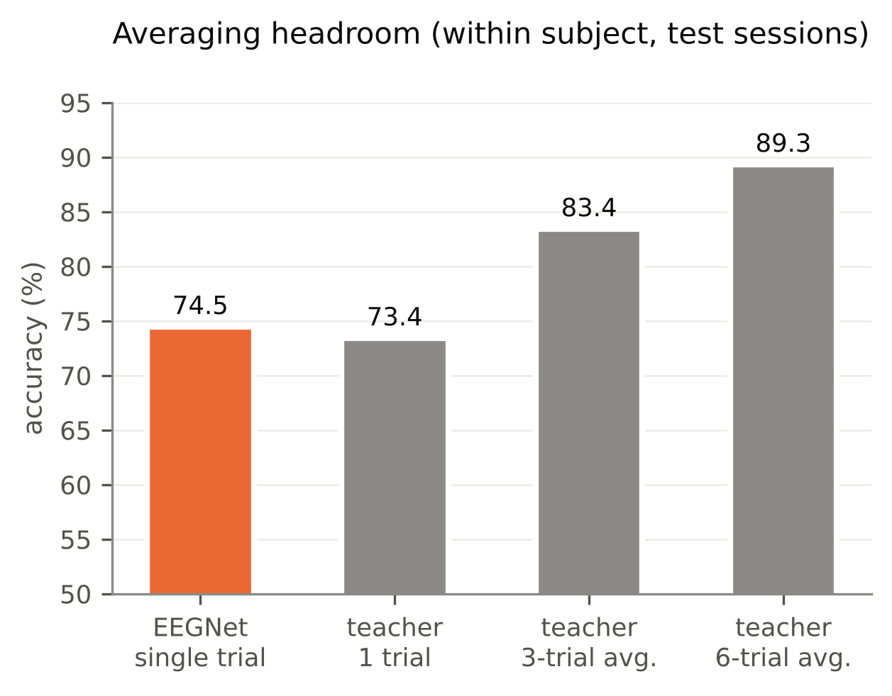
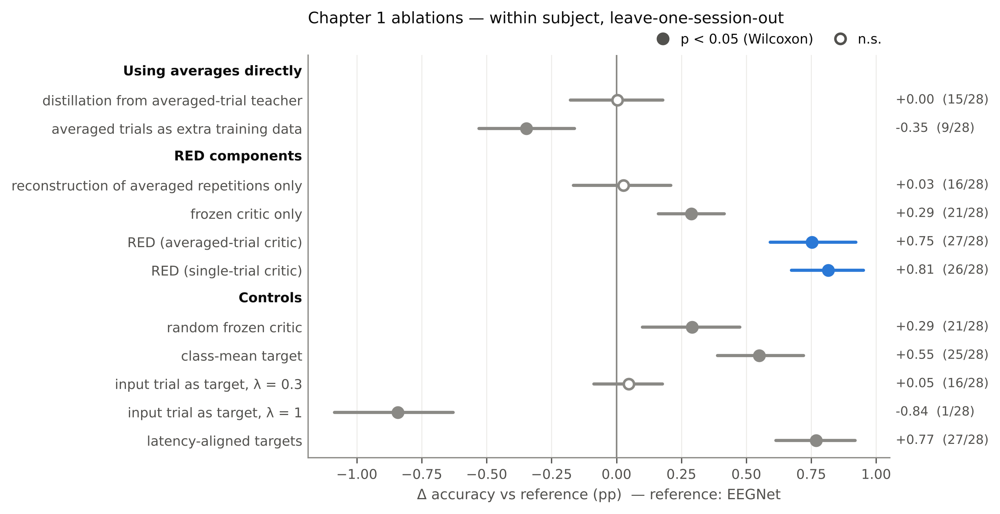
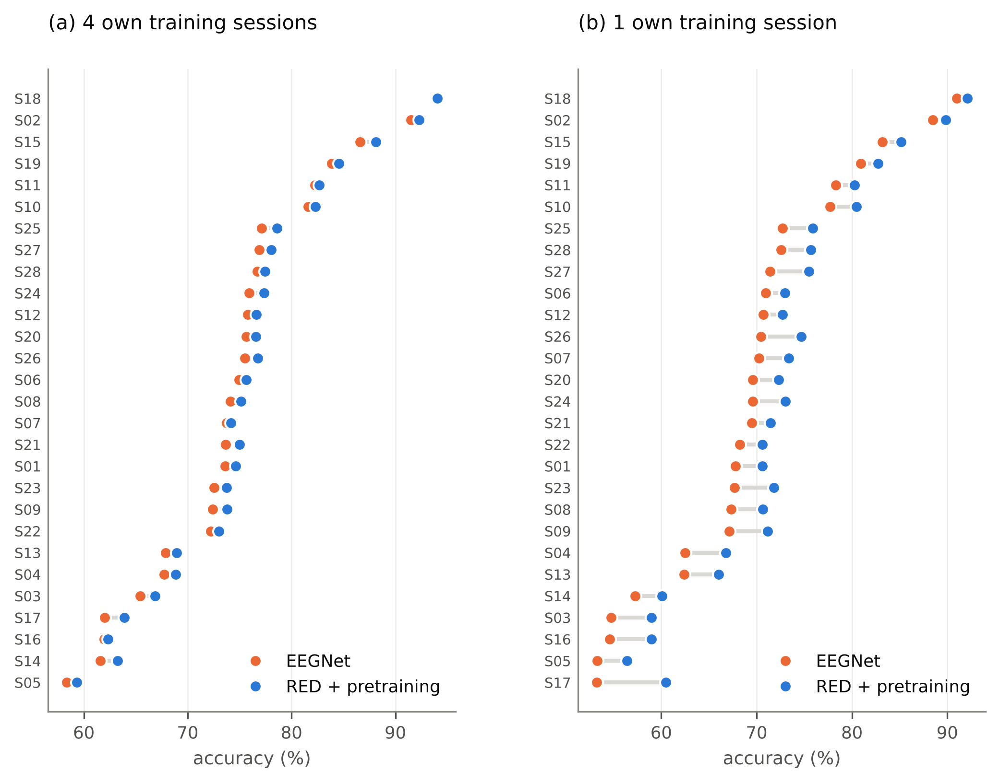
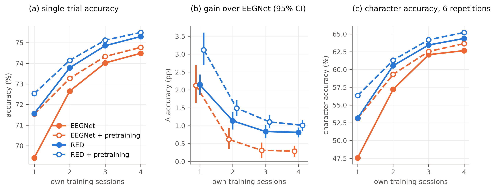
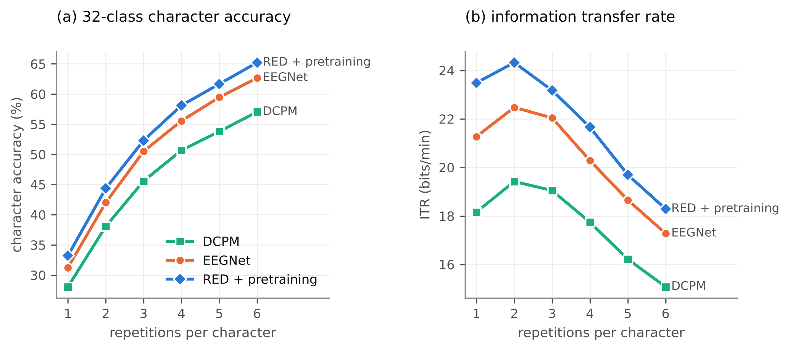

# Chapter 1 — Learning single-trial aVEP decoders from repetition structure

> **Draft.** Every number below is computed from the committed results by
> `scripts/make_thesis_figures.py` (values in `figures/figure_data.json`) or taken from the round
> reports in `reports/`. `[CITE]` marks a reference still to be inserted. Figures are in `figures/` as
> PNG (300 dpi) and PDF.

## 1.1 Introduction

**The decoding problem.**

- The asymmetric visual evoked potential (aVEP) speller encodes each of 32 characters as a 5-bit
  code [CITE dataset paper].
- Each bit is shown as a lateral apparent-motion stimulus, either left→right (bit 0) or right→left
  (bit 1). The whole code is repeated six times.
- A decoder must classify the motion direction from single 200-ms evoked responses, which are small
  compared with the background EEG.
- The best single-trial decoders reach about 74% within a subject. Character-level performance comes
  from accumulating evidence over the repetitions.

**Why repetitions matter.**

- Averaging the repetitions of one bit makes the response much easier to see. A classifier evaluated
  on 6-trial averages reaches about 89% (Figure 1.1).
- This information is not available at test time, when each trial must be decoded on its own.
- It is available during training, because every calibration session contains all repetitions of
  every bit.

**A practical constraint.**

- A speller is only usable after a calibration recording.
- The shorter that recording, the more practical the system, but a decoder trained on less data is
  less accurate.
- A method that uses the calibration data more efficiently therefore matters most when calibration
  is short.

**Research questions.**

| | Question |
|---|---|
| RQ1.1 | Can information that only becomes visible through averaging be transferred to a single-trial decoder, and through which route? |
| RQ1.2 | Which components of a successful route are necessary, and why? |
| RQ1.3 | Is the repetition structure complementary to the other available source of extra information, other subjects' data? |
| RQ1.4 | How much calibration data does the method save, and does it help most when calibration is short? |
| RQ1.5 | Do the single-trial gains carry over to character accuracy and information-transfer rate? |

**Contributions.**

1. **A controlled study of transfer routes.** The obvious ways of using averaged trials do not help
   a single-trial decoder: distillation from a teacher that sees averages, and averages added as
   training samples.
2. **Recoverable-ERP Distillation (RED), and its mechanism.**
   - *Objective:* the single-trial network reconstructs the average of the *other* repetitions of
     the trial's bit (a Noise2Noise target), and a frozen classifier judges that reconstruction.
   - *Cost:* RED adds nothing at inference; the deployed model is an unchanged EEGNet.
   - *Mechanism:* controls show that averaging is necessary in the target but not in the teacher,
     and that the critic is necessary.
3. **Complementarity with cross-subject pretraining.** Initialising from a model trained on the other
   subjects and the RED objective exploit different information. Their gains add up.
4. **Calibration efficiency.**
   - With 1, 2, 3 and 4 own training sessions, RED + pretraining improves every one of the 28
     subjects at every data level.
   - The gain grows to +3.1 pp single-trial and +8.8 pp character accuracy with one session.
   - With n sessions it matches or beats EEGNet with n + 1.
5. **A character-level evaluation** of accuracy and ITR against the number of repetitions.

**Scope.** This chapter concerns a known subject with labelled calibration sessions. Other subjects'
data are used only for pretraining. New subjects without labels, and adaptation at test time, belong
to Chapter 2.

## 1.2 Related work

*(To be written. Points to cover; citations still to be inserted.)*

- aVEP and motion-onset VEP spellers; the dataset and its original decoding pipeline [CITE].
- Single-trial ERP decoders: xDAWN/LDA, DCPM [CITE], EEGNet [CITE] and other compact CNNs [CITE].
- Learning using privileged information, and knowledge distillation from privileged views [CITE
  Vapnik; Lopez-Paz; Hinton].
- Noise2Noise and self-supervised denoising of signals with independent noise [CITE Lehtinen].
- Auxiliary reconstruction objectives and denoising in EEG deep learning [CITE].
- Calibration reduction in BCIs: transfer learning, cross-subject pretraining and fine-tuning
  [CITE].
- Use of repetitions in ERP-BCI calibration and decoding: averaging, dynamic stopping [CITE].

## 1.3 Data and protocol

**Dataset.**

- 28 subjects, 6 sessions each, 480 trials per session.
- 21 parieto-occipital channels, recorded at 200 Hz.
- One trial is one motion stimulus.
- Each character consists of 5 bits; each bit is repeated 6 times.
- A **repetition group** contains the up to six trials of one bit, identified by
  (subject, session, character, bit position).

**Preprocessing** (`docs/preprocessing.md`, verified in `reports/preprocessing_verification.md`):

1. Zero-phase FIR band-pass filter, 1–30 Hz (661 taps).
2. Bad channels (standard deviation more than 3× the median) replaced by spherical-spline
   interpolation.
3. Common-average reference.
4. Epoch window 0.05–0.34 s after stimulus onset, giving 58 samples.
5. Trials with peak-to-peak amplitude above 100 µV are flagged as artifacts and excluded.

**Main protocol.**

- Within subject, leave one session out: 6 folds per subject, 168 folds in total.
- In the fold that tests session k:
  - session (k mod 6) + 1 is the validation session, used only for early stopping;
  - the remaining 4 sessions are the **own training sessions**.
- Groups, averages and reconstruction targets are always built from the training sessions of the
  fold, so no test-session repetition is ever seen during training.

**Limited-calibration protocol.**

- Same folds, same test and validation sessions, but only n ∈ {1, 2, 3} of the 4 own training
  sessions are used. The main protocol is n = 4.
- The n sessions are taken in cyclic order after the validation session, skipping the test session
  (`aved.data.limit_train_sessions`). The choice is:
  - identical for every method and seed;
  - nested: the n = 1 session is part of n = 2, which is part of n = 3;
  - balanced: each session is the single training session in exactly one fold per subject.

**Statistics.**

- Every method is run with 3 seeds.
- Subject-level accuracy: averaged over seeds, and pooled over the 6 test sessions weighted by trial
  count.
- Paired differences between methods, with 95% bootstrap confidence intervals over subjects (4000
  resamples).
- Two-sided Wilcoxon signed-rank tests, n = 28.

## 1.4 Method

### 1.4.1 Why averaged information does not transfer naively

**A model of a trial.** Let x be a single trial of class y. Within one repetition group, a trial is

  x_i = s_y + c + n_i,

where:

- s_y is the class-specific evoked response;
- c is the overlap from neighbouring stimuli, shared by the whole group because all members have the
  same neighbouring code bits;
- n_i is noise, independent across repetitions.

The average of k repetitions reduces the noise variance by a factor of k.

**A preliminary LDA analysis** (`docs/chapter1_red.md` §1) shows two things:

| Training data | Test data | Accuracy |
|---|---|---|
| Single trials | Single trials | 72.0% |
| Single trials | 6-trial averages | 86.6% |
| 3-trial averages | Single trials | 69.0% |

- A single-trial classifier gains a lot from averaged *test* inputs.
- A classifier *trained* on 3-trial averages is worse on single trials than one trained on single
  trials.

The decision function suited to averages does not suit single trials. So the question is not how to
show the decoder averages, but how to make averaging shape the *features* it learns from single
trials.

### 1.4.2 Recoverable-ERP Distillation (RED)

**Student.**

- The student is EEGNet-8,2 [CITE], identical to the baseline.
- During training only, a **linear ERP decoder** D reads the output of EEGNet's first block
  (16 virtual sources × 14 time steps). D consists of:
  - a shared temporal up-sampling (14 → 58 samples);
  - a learned forward model (16 sources → 21 channels).
- Because D is linear, any reconstruction must be expressible through the student's own spatial
  filters.
- D is discarded after training.

**Noise2Noise reconstruction target.** For a trial x_i in group G, the target is the leave-one-out
average of its group:

  a_i = (1 / (|G| − 1)) Σ_{j ∈ G, j ≠ i} x_j.

The noise in a_i is independent of the noise in x_i. Minimising E‖D(f(x_i)) − a_i‖² therefore has
the same minimiser as regressing onto the clean signal, E[s_y + c | x_i] [CITE Noise2Noise].

The reconstruction loss is

  L_rec = MSE(D f(x), a) + β · MSE(P D f(x), P a),

where P computes the left-minus-right differences of the 9 mirror-symmetric channel pairs. This
gives extra weight to the lateralised part of the signal, which carries the direction information.
We use β = 1.

**Frozen critic.**

- A teacher network T with the same architecture is trained on the fold's own training sessions
  before the student.
- In the original variant, T is trained on random k-trial averages (k ∈ {2, 3, 6}). In the final
  variant it is trained on single trials (Section 1.5.3 shows that the two are equivalent).
- T is then frozen and judges the student's reconstruction:

  L_critic = CE(T(D f(x)), y) + τ² · KL(T(D f(x)) ‖ S(x)),

  where S(x) is the student's prediction from the same features.
  - The first term asks the reconstruction to be classifiable.
  - The second distils T's verdict on that reconstruction into the student's classifier.
- We use τ = 2.

**Total objective.**

  L = CE(S(x), y) + λ_rec · L_rec + λ_critic · L_critic,  with λ_rec = 1 and λ_critic = 0.5.

**Insensitivity to settings.** The defaults were set a priori. A validation-only sweep over
λ_critic ∈ {0.5, 1, 2}, λ_rec ∈ {0.3, 1, 3}, τ ∈ {1, 2, 4}, teacher k and β changed the test result
by only +0.04 pp (n.s.; `reports/chapter1_round2_analysis.md`).

**Inference.** Only the EEGNet is kept. Parameter count, latency and memory are those of the
baseline.

### 1.4.3 Cross-subject initialisation

**Pretraining.** For each target subject:

- one EEGNet is trained on the other 27 subjects;
- early stopping uses 3 of them, so 24 are used for training (`scripts/pretrain_subjects.py`);
- every subject is z-scored per channel with its own statistics, which matches the per-subject
  normalisation of the within-subject folds;
- the target subject is never seen.

**Fine-tuning.**

- Settings, folds and early stopping are exactly those of training from scratch; only the
  initialisation differs.
- The pretrained model itself is epoch 0 of early stopping, so fine-tuning can never select a model
  that validates worse than its initialisation.
- For RED, both the teacher and the student's EEGNet start from the pretrained model. The ERP
  decoder starts random.

**Notation.** "+ pretraining" denotes fine-tuning from this model.

### 1.4.4 Variants and controls

| Variant | Purpose |
|---|---|
| `kd_naive` | Distil T's prediction on the group average into S (classic distillation from a privileged view) |
| `eegnet_avgaug` | Add random k-trial averages as training samples, cross-entropy only |
| `red_n2n` | Reconstruction loss only, no critic |
| `red_critic` | Critic loss only |
| `red` | Full method, critic trained on averages |
| **`red_selfteacher`** | **Full method, critic trained on single trials. This is "RED" in Sections 1.5.4–1.5.6.** |
| `red_randteacher` | Randomly initialised frozen critic |
| `red_classmean` | Target = the subject's class mean instead of the group average (drops the neighbour context c) |
| `red_autoenc_self` | Target = the input trial itself (autoencoder), single-trial critic; λ_rec ∈ {1, 0.3} |
| `red_aligned` | Group targets latency-aligned by Woody's method before averaging |
| `eegnet@ft`, `red_selfteacher@ft` | EEGNet and RED with cross-subject pretraining |

## 1.5 Results

### 1.5.1 Baselines and averaging headroom

**Within-subject single-trial accuracy, 4 own training sessions.**

| Method | Accuracy |
|---|---|
| EEGNet | 74.48% |
| DCPM [CITE] | 72.57% |

All further comparisons use EEGNet as the reference.

**Averaging headroom.** The teacher evaluated on test-session averages shows how much information
averaging reveals (Figure 1.1):

| Teacher input | Accuracy |
|---|---|
| Single trial | 73.4% |
| 3-trial average | 83.4% |
| 6-trial average | 89.3% |

**Figure 1.1.** Single-trial EEGNet accuracy compared with the teacher evaluated on single trials and
on 3- and 6-trial averages of the test session. The 15-point gap from 1 to 6 trials is present in the
data but not available to a single-trial decoder.

### 1.5.2 Transfer routes: using averages directly does not help (RQ1.1)

**Figure 1.2.** Change in single-trial accuracy relative to EEGNet, within subject, 4 own training
sessions. Points are means over 28 subjects (3 seeds each); bars are 95% bootstrap confidence
intervals. Filled points mark p < 0.05 (Wilcoxon). The right column gives the mean and the number of
subjects improved.

| Method | Δ vs EEGNet (pp) | 95% CI | Subjects improved | p |
|---|---|---|---|---|
| `kd_naive` (distillation from an averaged-trial teacher) | +0.00 | [−0.18, 0.18] | 15/28 | 0.77 |
| `eegnet_avgaug` (averages as training samples) | −0.35 | [−0.53, −0.16] | 9/28 | 0.002 |

The two direct routes fail:

- distillation from a teacher that sees averages leaves accuracy unchanged;
- adding averages as training samples lowers it.

This matches Section 1.4.1: averages call for a different decision function from single trials.

### 1.5.3 RED and its mechanism (RQ1.1, RQ1.2)

| Method | Δ vs EEGNet (pp) | 95% CI | Subjects improved | p |
|---|---|---|---|---|
| `red_n2n` (reconstruction only) | +0.03 | [−0.17, 0.21] | 16/28 | 0.71 |
| `red_critic` (critic only) | +0.29 | [0.16, 0.42] | 21/28 | 0.001 |
| **`red`** | **+0.75** | [0.59, 0.92] | **27/28** | < 10⁻⁴ |
| **`red_selfteacher`** | **+0.81** | [0.67, 0.95] | **26/28** | < 10⁻⁴ |
| `red_randteacher` | +0.29 | [0.10, 0.48] | 21/28 | 0.011 |
| `red_classmean` | +0.55 | [0.39, 0.72] | 25/28 | < 10⁻⁴ |
| `red_autoenc_self`, λ = 0.3 | +0.05 | [−0.09, 0.18] | 16/28 | 0.33 |
| `red_autoenc_self`, λ = 1 | −0.84 | [−1.09, −0.63] | 1/28 | < 10⁻⁴ |
| `red_aligned` | +0.77 | [0.61, 0.92] | 27/28 | < 10⁻⁴ |

**RED needs both of its parts.**

| Component | Δ vs EEGNet (pp) |
|---|---|
| Reconstruction alone | +0.03 |
| Critic alone | +0.29 |
| Both together | +0.75 to +0.81 |

The gain of the full method is larger than the sum of its parts:

- the Noise2Noise target makes the encoder retain the part of the signal that is shared across
  repetitions;
- the critic makes that retained signal class-relevant.

**Averaging matters in the target, not in the teacher.**

- *Critic.* One trained on single trials is as good as one trained on averages (−0.06 pp, n.s.).
  Even a random frozen critic gives part of the gain (+0.29 pp).
- *Target.* Replacing the leave-one-out average by the input trial itself reverses the effect. At
  matched weight (λ = 1) it moves from +0.81 to −0.84 pp; all 28 subjects change in the same
  direction (`reports/chapter1_round3_analysis.md`).

This is the Noise2Noise prediction:

- with an independent-noise target, the optimal reconstruction is a denoised response;
- with the input as target, it is the identity, so the encoder is pushed to keep the noise.

**Matching the repetition context helps.**

- A class-mean target, which removes the neighbour overlap c, gives +0.55 pp against +0.75 pp for the
  group target.
- Latency-aligning the group before averaging gives no further gain.
- The useful target is therefore the plain average of the trial's own repetitions.
- Because the single-trial critic is simpler and at least as good, `red_selfteacher` is used from
  here on.

### 1.5.4 How much single-trial headroom remains?

With 4 own training sessions, RED gains under 1 pp. A diagnostic with shrinkage LDA
(`reports/chapter1_headroom_analysis.md`) shows why this is a property of the setting, not a weakness
of the method. LDA is a fair stand-in for EEGNet here: 74.2% against 74.5% on the same window.

- **The window's information is nearly used up.** A nonlinear deep model barely beats a linear one.
- **More own data gives diminishing returns.**

  | LDA training sessions | 1 | 2 | 3 | 4 | 5 |
  |---|---|---|---|---|---|
  | Accuracy | 69.8% | 72.6% | 73.6% | 74.4% | 74.9% |

  - A fit acc(n) = a − b·n^(−c) puts unlimited own data at about 78%, only about 3.4 pp above
    5 sessions. This is an extrapolation.
  - Any method that acts like additional calibration data — a regulariser such as RED — is bounded
    by this headroom.
- **There is no unused signal outside the window.** The next epoch alone decodes the current trial
  at 63.5%, but fusing it with the current epoch adds only +0.22 pp. Wider windows and explicit
  modelling of the neighbours' overlap do not help.
- **There are two remaining sources of information:**
  - other subjects' data (Section 1.5.5);
  - the larger headroom when calibration is short (Section 1.5.6).

### 1.5.5 Complementarity with cross-subject pretraining (RQ1.3)

| Comparison (4 own training sessions) | Δ (pp) | 95% CI | Subjects improved | p |
|---|---|---|---|---|
| EEGNet + pretraining − EEGNet | +0.29 | [0.13, 0.44] | 18/28 | 0.003 |
| RED − EEGNet | +0.81 | [0.67, 0.95] | 26/28 | 5 × 10⁻⁶ |
| RED + pretraining − EEGNet + pretraining | +0.72 | [0.55, 0.90] | 26/28 | 5 × 10⁻⁶ |
| RED + pretraining − RED | +0.20 | [0.09, 0.30] | 20/28 | 0.002 |
| **RED + pretraining − EEGNet** | **+1.01** | **[0.86, 1.16]** | **28/28** | 7 × 10⁻⁹ |

Source: `reports/round9_analysis.md`.

**Pretraining alone gives a small gain.**

- +0.29 pp, consistent with the small cross-subject prior found by the LDA diagnostic (+0.15 pp).
- The pretrained model reaches only 60.8% zero-shot on the target.
- It is never kept unchanged by fine-tuning, but fine-tuning from it converges earlier: median best
  epoch 136 against 168 from scratch.

**The two gains are nearly additive.**

- RED gives +0.81 pp from scratch and +0.72 pp on top of pretraining.
- Pretraining gives +0.29 pp alone and +0.20 pp on top of RED.
- RED exploits the subject's own repetition structure, pretraining the other subjects. The two
  sources are complementary.

**The combination improves every subject** (Figure 1.3a), across the whole range of baseline
accuracy (58–94%).

**Figure 1.3.** Single-trial accuracy per subject, EEGNet (orange) vs RED + pretraining (blue), with
(a) 4 and (b) 1 own training sessions. Subjects are sorted by EEGNet accuracy.

### 1.5.6 Limited calibration (RQ1.4)

**Figure 1.4.** (a) Single-trial accuracy, (b) gain over EEGNet with 95% CIs, and (c) character
accuracy at 6 repetitions, against the number of own training sessions. Colour encodes the objective
(orange EEGNet, blue RED); dashed lines with open markers denote pretrained initialisation.

**Single-trial accuracy (%)** (`reports/round10_analysis.md`):

| Own training sessions | 1 | 2 | 3 | 4 |
|---|---|---|---|---|
| EEGNet | 69.41 | 72.65 | 74.02 | 74.48 |
| EEGNet + pretraining | 71.54 | 73.27 | 74.33 | 74.77 |
| RED | 71.56 | 73.78 | 74.85 | 75.30 |
| **RED + pretraining** | **72.53** | **74.14** | **75.12** | **75.49** |

**Gains (pp).** Each cell: mean gain [95% CI], subjects improved.

| Comparison | 1 session | 2 sessions | 3 sessions | 4 sessions |
|---|---|---|---|---|
| RED − EEGNet | +2.14 [1.87, 2.43], 28/28 | +1.13 [0.90, 1.39], 28/28 | +0.84 [0.66, 1.03], 27/28 | +0.81 [0.67, 0.95], 26/28 |
| Pretraining − EEGNet | +2.13 [1.63, 2.70], 28/28 | +0.62 [0.35, 0.93], 23/28 | +0.31 [0.10, 0.53], 18/28 | +0.29 [0.13, 0.44], 18/28 |
| RED on top of pretraining | +0.99 [0.76, 1.21], 25/28 | +0.87 [0.63, 1.10], 26/28 | +0.79 [0.61, 1.00], 26/28 | +0.72 [0.55, 0.90], 26/28 |
| **RED + pretraining − EEGNet** | **+3.12** [2.70, 3.60], **28/28** | **+1.49** [1.28, 1.71], **28/28** | **+1.11** [0.93, 1.29], **28/28** | **+1.01** [0.86, 1.16], **28/28** |

All p ≤ 0.008. The combined gain is stable across seeds; at 1 session it is +2.85, +3.36 and +3.14 pp.

**Both components help most when calibration is short.**

| Component | Gain at 1 session | Gain at 4 sessions |
|---|---|---|
| RED | +2.14 pp | +0.81 pp (2.6× less) |
| Pretraining | +2.13 pp | +0.29 pp (7× less) |

This is the pattern expected from Section 1.5.4: both act like additional data, and what remains to
be gained shrinks as own data grow.

**RED is the robust component.** On top of pretraining it adds +0.7 to +1.0 pp at every data level.
Pretraining matters mainly for very short calibration.

**Calibration saved.** RED + pretraining with n sessions matches or beats EEGNet with n + 1 sessions:

| RED + pretraining with | Accuracy | EEGNet with | Accuracy |
|---|---|---|---|
| 2 sessions | 74.14% | 3 sessions | 74.02% |
| 3 sessions | 75.12% | 4 sessions | 74.48% |

- At 2 sessions this saves a third of the calibration recording.
- On a fit of EEGNet's own curve, 1 session of RED + pretraining is worth 1.9 EEGNet sessions, and
  2 sessions are worth 3.3.

**Who gains most.** With 1 session, the combined gain is largest for the weakest subjects (Spearman
ρ = −0.70 with baseline accuracy, p = 3 × 10⁻⁵; Figure 1.3b). For example, Sub17 rises from 53% to
61%.

### 1.5.7 Character level (RQ1.5)

**Decoding.**

- Character decisions sum the single-trial log-odds over the R repetitions of each of the 5 bits,
  then pick the nearest of the 32 codewords (`scripts/char_level.py`).
- ITR uses the Wolpaw formula with N = 32 and a selection time T = 1.2 R + 1 s.

**Figure 1.5.** (a) Character accuracy (chance 3.1%) and (b) ITR against the number of repetitions,
within subject, 4 own training sessions.

**4 own training sessions:**

| Repetitions R | 1 | 2 | 3 | 4 | 5 | 6 |
|---|---|---|---|---|---|---|
| DCPM, accuracy (%) | 28.1 | 38.1 | 45.6 | 50.7 | 53.8 | 57.0 |
| EEGNet, accuracy (%) | 31.3 | 42.0 | 50.5 | 55.6 | 59.5 | 62.7 |
| EEGNet + pretraining, accuracy (%) | 32.3 | 43.1 | 51.0 | 56.7 | 60.1 | 63.7 |
| RED, accuracy (%) | 32.2 | 44.3 | 52.2 | 57.0 | 61.4 | 64.4 |
| **RED + pretraining, accuracy (%)** | **33.2** | **44.4** | **52.3** | **58.1** | **61.7** | **65.2** |
| DCPM, ITR (bits/min) | 18.2 | 19.4 | 19.1 | 17.7 | 16.2 | 15.1 |
| EEGNet, ITR (bits/min) | 21.3 | 22.5 | 22.0 | 20.3 | 18.7 | 17.3 |
| **RED + pretraining, ITR (bits/min)** | **23.5** | **24.3** | **23.2** | **21.7** | **19.7** | **18.3** |

- RED + pretraining gains +1.8 to +2.6 pp character accuracy over EEGNet at every repetition count
  (p < 10⁻⁴ at R = 1, 2 and 6, the counts tested).
- The single-trial gain grows at character level because it accumulates over 5 bits × R repetitions.
- Peak ITR:

  | Method | Peak ITR (bits/min) |
  |---|---|
  | RED + pretraining | 24.3 |
  | EEGNet | 22.5 |
  | DCPM | 19.4 |

**Short calibration** (6 repetitions; peak ITR over R):

| Own training sessions | Method | Character accuracy | Peak ITR |
|---|---|---|---|
| 1 | EEGNet | 47.6% | 14.7 bits/min |
| 1 | EEGNet + pretraining | 53.1% | 17.2 bits/min |
| 1 | RED | 53.1% | 17.7 bits/min |
| 1 | **RED + pretraining** | **56.3%** | **19.0 bits/min** |
| 2 | EEGNet | 57.2% | 19.0 bits/min |
| 2 | **RED + pretraining** | **61.3%** | **22.2 bits/min** |

**With one calibration session:**

- RED + pretraining raises 6-repetition character accuracy by **+8.8 pp** (p = 4 × 10⁻⁶);
- at 1–5 repetitions the gain is +5.2 to +7.9 pp;
- peak ITR rises by 29%;
- with one session, the method comes close to EEGNet's character accuracy with two (56.3% against
  57.2%).

## 1.6 Discussion

**How averaged repetitions can help single trials.**

- Information visible in averaged repetitions can improve a single-trial decoder, but only through a
  specific route.
- Using averages as inputs, whether to the student or to a distillation teacher, gives nothing or
  harms.
- What works is using the *other* repetitions of a trial as a noisy target that the trial's own
  features must predict.
- The effective ingredient is the independence of noise across repetitions, which turns a
  reconstruction loss into a denoising loss. The critic makes that denoising class-relevant.

**Relation to privileged-information learning.** RED can be read as learning with privileged
information [CITE], where the privileged view is the set of sibling repetitions. The results qualify
the usual distillation view: the privileged view is useful as a *target for the representation*, not
as the input of a teacher whose outputs are imitated.

**Why the effect size depends on calibration.**

- RED behaves like additional calibration data. Its gain is therefore bounded by what more data
  could still deliver: little with 4 sessions (Section 1.5.4), much more with 1.
- Read in isolation, the 0.8-pp gain at full calibration understates the method. The same objective
  gives +2.1 pp, and +3.1 pp with pretraining, when calibration is short.
- Short calibration is the regime that decides whether a speller is practical.

**Two complementary sources of information.**

- Cross-subject pretraining supplies population knowledge; RED supplies the subject's own repetition
  structure.
- Their near-additivity, and the fact that RED's contribution survives pretraining at every data
  level, show that RED does not merely substitute for a better initialisation.

**Practical value.**

- No inference cost.
- No extra data: the repetitions are already in every calibration session, and other subjects' data
  are available in any existing dataset.
- Every subject improves at every data level.
- Calibration time is saved: n sessions with RED + pretraining match or beat n + 1 sessions with
  EEGNet.

## 1.7 Limitations

- **Single-trial ceiling.** With 4 own sessions the attainable single-trial gain is a few points at
  most. RED + pretraining recovers about 30% of the estimated headroom, which is itself extrapolated
  from five data points.
- **Granularity of calibration.** Calibration was reduced in whole sessions of 480 trials. Finer
  steps, such as part of a session, were not tested.
- **Pretraining dataset.** The pretraining data come from the same dataset and recording setup.
  Pretraining across datasets is untested.
- **Pooled protocol.** In the pooled protocol (one model for all subjects) RED alone gave no
  significant gain, because the pooled teacher is weak (66.1% single-trial;
  `reports/chapter1_round1_analysis.md`). Cross-subject variability is the subject of Chapter 2.
- **Chapter 2 link.** RED-trained cross-subject experts are not better zero-shot, but adapt better
  without labels (+0.68 pp; Chapter 2, Section 2.6.5).
- **DCPM baseline.** DCPM was run with this thesis's preprocessing and all 28 subjects. Its accuracy
  is lower than in the original publication, which reported a selected subset of subjects.

## 1.8 Conclusion

**The method.** The repetition structure of the aVEP speller can supervise a single-trial decoder.
RED predicts the average of a trial's other repetitions from that trial's own features, and lets a
frozen critic judge the prediction. The controls identify why it works:

- noise independence of the target is necessary;
- a critic is necessary;
- a teacher trained on averaged data is not necessary.

**The results.**

- RED is complementary to cross-subject pretraining.
- The combination improves every subject, at no inference cost.
- Its value is largest where calibration is short. With one calibration session it gains +3.1 pp
  single-trial accuracy and +8.8 pp character accuracy.
- With n sessions it matches or beats EEGNet with n + 1.

**Outlook.** Chapter 2 turns to the extreme case of short calibration: a new subject without any
labels. There the same repetition structure supports label-free routing and adaptation.

---

### Figure list

| Figure | File | Source data |
|---|---|---|
| 1.1 | `figures/ch1_averaging_headroom.png` | `results/eegnet/within`; teacher diagnostics in `results/red/within/*/folds` |
| 1.2 | `figures/ch1_ablation.png` | `results/<variant>/within` |
| 1.3 | `figures/ch1_per_subject.png` | `results/eegnet`, `results/red_selfteacher@ft`, `results/eegnet@cal1`, `results/red_selfteacher@ft_cal1` |
| 1.4 | `figures/ch1_calibration.png` | `results/<method>@cal<N>`, `results/<method>@ft_cal<N>` and the 4-session runs |
| 1.5 | `figures/ch1_character_level.png` | stored single-trial predictions, `scripts/char_level.py` |
