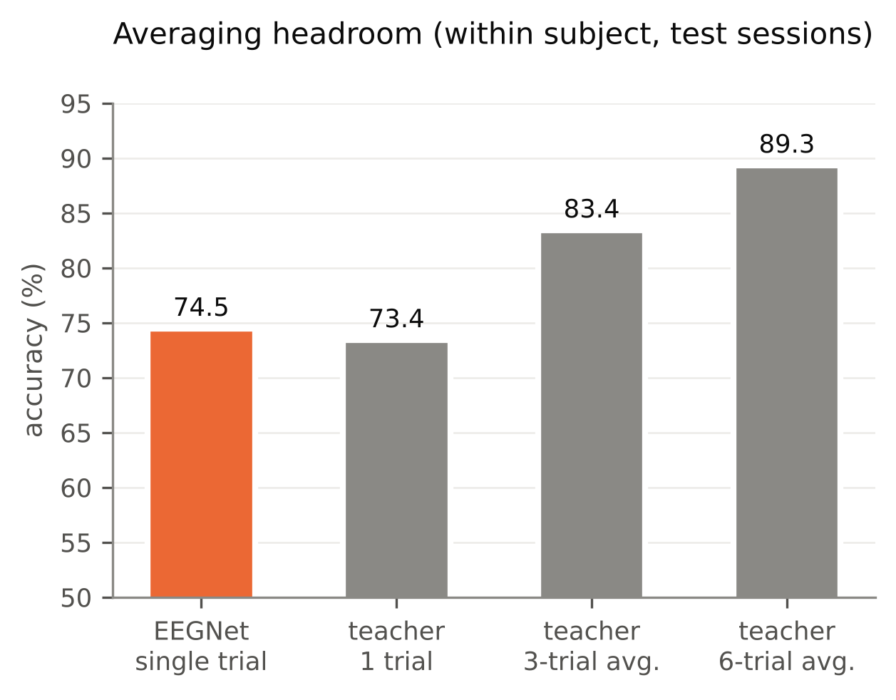
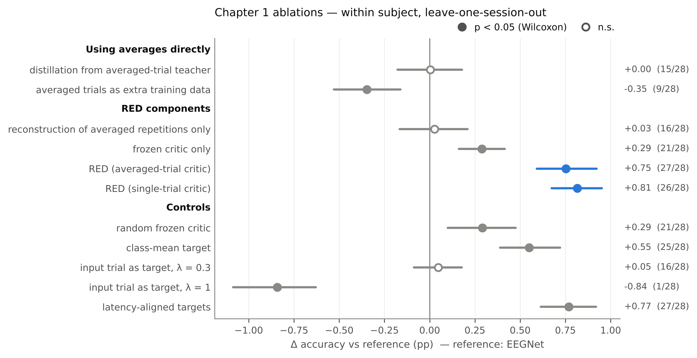
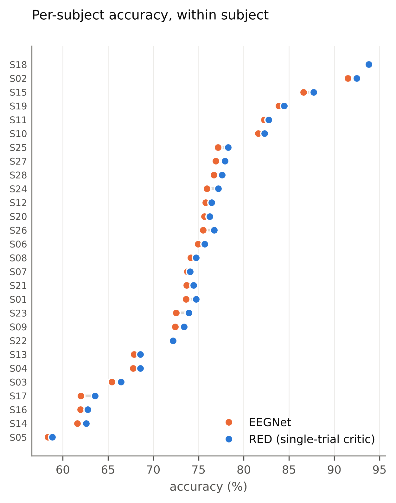
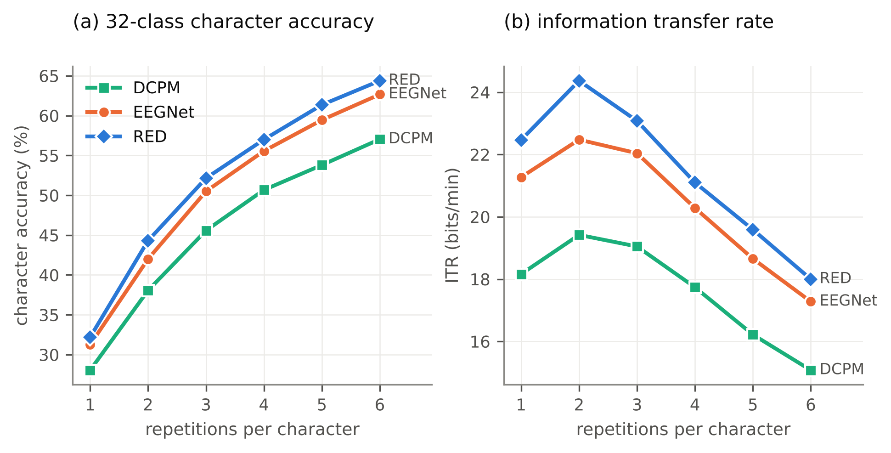

# Chapter 1 — Learning single-trial aVEP decoders from repetition structure

> **Draft.** Every number below is computed from the committed results by
> `scripts/make_thesis_figures.py` (values in `figures/figure_data.json`) or taken from the round reports
> in `reports/`. `[CITE]` marks a reference still to be inserted. Figures are in `figures/` as PNG
> (300 dpi) and PDF.

## 1.1 Introduction

The asymmetric visual evoked potential (aVEP) speller encodes each of 32 characters as a 5-bit code.
Each bit is shown as a lateral apparent-motion stimulus, either left→right (bit 0) or right→left
(bit 1), and the whole code is repeated six times [CITE dataset paper]. A decoder has to classify
the direction of single, 200-ms, visually evoked responses. These responses are small compared with
the background EEG. The best single-trial decoders reach about 74% within a subject (Section 1.5),
and character-level performance comes from accumulating evidence over repetitions.

Averaging the repetitions of one bit makes the response much easier to see. A classifier evaluated
on 6-trial averages reaches about 89% (Figure 1.1). That information is not available at test time,
when each trial must be decoded on its own. It is available during training, because the
calibration data contain every repetition of every bit. This chapter asks whether, and how, a
single-trial decoder can benefit from the structure of averaged repetitions it never sees at test
time.

**Research questions.**

- **RQ1.1** Can information that only becomes visible through averaging repetitions be transferred to
  a single-trial decoder, and through which route?
- **RQ1.2** Which components of a successful route are necessary, and why?
- **RQ1.3** Does the single-trial gain matter at the level that counts for a speller, characters
  and information-transfer rate?

**Contributions.**

1. **A controlled study of transfer routes.** The obvious ways of using averaged trials do not help a
   single-trial decoder. These are knowledge distillation from a teacher that sees averages, and
   adding averages as training samples.
2. **Recoverable-ERP Distillation (RED).** A training objective in which the single-trial network
   reconstructs the average of the *other* repetitions of the trial's bit (a Noise2Noise target),
   and a frozen classifier judges that reconstruction. RED adds nothing at inference: the deployed
   model is an unchanged EEGNet. It improves single-trial accuracy for 27 of 28 subjects.
3. **A mechanism analysis.** Controls separate three factors: averaging in the *target*, which is
   necessary, averaging in the *teacher*, which is not, and the critic, which is necessary.
   The Noise2Noise argument explains these results.
4. **A character-level evaluation.** Character accuracy and information-transfer rate (ITR) as a
   function of the number of repetitions, for DCPM, EEGNet and RED.

**Scope.** This chapter concerns a known subject with labelled calibration sessions. New subjects
and adaptation at test time belong to Chapter 2.

## 1.2 Related work

*(To be written. Points to cover; citations still to be inserted.)*

- aVEP and motion-onset VEP spellers; the dataset and its original decoding pipeline [CITE].
- Single-trial ERP decoders: xDAWN/LDA, DCPM [CITE], EEGNet [CITE] and other compact CNNs [CITE].
- Learning using privileged information, and knowledge distillation from privileged views [CITE
  Vapnik; Lopez-Paz; Hinton].
- Noise2Noise and self-supervised denoising of signals with independent noise [CITE Lehtinen].
- Auxiliary reconstruction objectives and denoising in EEG deep learning [CITE].
- Use of repetitions in ERP-BCI calibration: averaging, dynamic stopping [CITE].

## 1.3 Data and protocol

**Dataset.**

- 28 subjects, 6 sessions each, 480 trials per session.
- 21 parieto-occipital channels, recorded at 200 Hz.
- One trial is one motion stimulus.
- Each character consists of 5 bits; each bit is repeated 6 times.
- A **repetition group** contains the up to six trials of one bit, identified by
  (subject, session, character, bit position).

**Preprocessing** (`docs/preprocessing.md`, verified in `reports/preprocessing_verification.md`):

1. Zero-phase FIR band-pass filter, 1–30 Hz (661 taps).
2. Bad channels (standard deviation more than 3× the median) replaced by spherical-spline
   interpolation.
3. Common-average reference.
4. Epoch window 0.05–0.34 s after stimulus onset, giving 58 samples.
5. Trials with peak-to-peak amplitude above 100 µV are flagged as artifacts and excluded.

**Protocol.**

- Within subject, leave one session out: 6 folds per subject, 168 folds in total.
- The validation session of fold *k* is session (k mod 6) + 1. It is used only for early stopping.
- Groups, averages and reconstruction targets are always built from the training sessions of the
  fold, so no test-session repetition is ever seen during training.
- Every method is run with 3 seeds.

**Statistics.**

- Subject-level accuracy: averaged over seeds, and pooled over the 6 test sessions weighted by trial
  count.
- Paired differences between methods, with 95% bootstrap confidence intervals over subjects (4000
  resamples).
- Two-sided Wilcoxon signed-rank tests, n = 28.

## 1.4 Method

### 1.4.1 Why averaged information does not transfer naively

Let x be a single trial of class y. Within one repetition group, a simple model of a trial is

  x_i = s_y + c + n_i,

where s_y is the class-specific evoked response, c is the overlap from neighbouring stimuli (shared
by the whole group, because all members have the same neighbouring code bits), and n_i is noise
independent across repetitions. The average of k repetitions reduces the noise variance by a factor
of k.

A preliminary analysis with shrinkage LDA (`docs/chapter1_red.md` §1) shows two things:

- a single-trial classifier gains from averaged *test* inputs: 72.0% on single trials, 86.6% on
  6-trial averages;
- a classifier *trained* on 3-trial averages is worse on single trials than one trained on single
  trials: 69.0% vs 72.0%.

The decision function suited to the averaged distribution does not suit the single-trial
distribution. So the question is not how to show the decoder averages, but how to make averaging
shape the *features* the decoder learns from single trials.

### 1.4.2 Recoverable-ERP Distillation

**Student.** The student is EEGNet-8,2 [CITE], identical to the baseline. During training only, a
**linear ERP decoder** D reads the output of EEGNet's first block (16 virtual sources × 14 time
steps). It applies a shared temporal up-sampling (14 → 58 samples) and a learned forward model
(16 sources → 21 channels). Because D is linear, any reconstruction must be expressible through the
student's own spatial filters. D is discarded after training.

**Noise2Noise reconstruction target.** For a trial x_i in group G, the target is the leave-one-out
average of its group:

  a_i = (1 / (|G| − 1)) Σ_{j ∈ G, j ≠ i} x_j.

The noise in a_i is independent of the noise in x_i. Minimising the squared error E‖D(f(x_i)) − a_i‖²
therefore has the same minimiser as regressing onto the clean signal, E[s_y + c | x_i] [CITE
Noise2Noise]. The reconstruction loss is

  L_rec = MSE(D f(x), a) + β · MSE(P D f(x), P a),

where P computes the left-minus-right differences of the 9 mirror-symmetric channel pairs. This
gives extra weight to the lateralised part of the signal, which carries the direction information.
We use β = 1.

**Frozen critic.** A teacher network T with the same architecture is trained beforehand. In the main
variant, T is trained on random k-trial averages (k ∈ {2, 3, 6}). In the single-trial-critic
variant, it is trained on single trials. T is then frozen and judges the student's reconstruction:

  L_critic = CE(T(D f(x)), y) + τ² · KL(T(D f(x)) ‖ S(x)),

where S(x) is the student's prediction from the same features.

- The first term asks the reconstruction to be classifiable.
- The second distils T's verdict on that reconstruction into the student's classifier.

We use τ = 2.

**Total objective.**

  L = CE(S(x), y) + λ_rec · L_rec + λ_critic · L_critic,  with λ_rec = 1 and λ_critic = 0.5.

The defaults were set a priori. A validation-only sweep over λ_critic ∈ {0.5, 1, 2},
λ_rec ∈ {0.3, 1, 3}, τ ∈ {1, 2, 4}, teacher k and β changed the test result by +0.04 pp (n.s.;
`reports/chapter1_round2_analysis.md`). RED is therefore insensitive to these settings, and the
defaults are reported.

**Inference.** Only the EEGNet is kept. The parameter count, latency and memory are those of the
baseline.

### 1.4.3 Variants and controls

| Variant | Purpose |
|---|---|
| `kd_naive` | Distil T's prediction on the group average into S (classic distillation from a privileged view) |
| `eegnet_avgaug` | Add random k-trial averages as training samples, cross-entropy only |
| `red_n2n` | Reconstruction loss only, no critic |
| `red_critic` | Critic loss only (T judges the student's features, no reconstruction target) |
| **`red`** | Full method, averaged-trial critic |
| **`red_selfteacher`** | Full method, critic trained on single trials |
| `red_randteacher` | Randomly initialised frozen critic |
| `red_classmean` | Target = the subject's class mean instead of the group average (drops the neighbour context c) |
| `red_autoenc_self` | Target = the input trial itself (autoencoder), single-trial critic; λ_rec ∈ {1, 0.3} |
| `red_aligned` | Group targets latency-aligned by Woody's method before averaging |

## 1.5 Results

### 1.5.1 Baselines and averaging headroom

**Within-subject single-trial accuracy.**

| Method | Accuracy |
|---|---|
| EEGNet | 74.48% |
| DCPM [CITE] | 72.57% |

All further comparisons use EEGNet as the reference.

**Averaging headroom.** The teacher evaluated on test-session averages gives an upper bound on what
averaging reveals (Figure 1.1):

| Teacher input | Accuracy |
|---|---|
| Single trial | 73.4% |
| 3-trial average | 83.4% |
| 6-trial average | 89.3% |

**Figure 1.1.** Single-trial EEGNet accuracy compared with the teacher evaluated on single trials and
on 3- and 6-trial averages of the test session. The 15-point gap from 1 to 6 trials is information
that is present in the data but not available to a single-trial decoder.

### 1.5.2 Transfer routes and ablations (RQ1.1, RQ1.2)

Figure 1.2 shows every variant as a paired difference from EEGNet.

**Figure 1.2.** Change in single-trial accuracy relative to EEGNet, within subject. Points are means
over 28 subjects (3 seeds each); bars are 95% bootstrap confidence intervals. Filled points mark
p < 0.05 (Wilcoxon). The right column gives the mean and the number of subjects improved.

| Method | Δ vs EEGNet (pp) | 95% CI | Subjects improved | p |
|---|---|---|---|---|
| `kd_naive` | +0.00 | [−0.18, 0.18] | 15/28 | 0.77 |
| `eegnet_avgaug` | −0.35 | [−0.53, −0.16] | 9/28 | 0.002 |
| `red_n2n` | +0.03 | [−0.17, 0.21] | 16/28 | 0.71 |
| `red_critic` | +0.29 | [0.16, 0.42] | 21/28 | 0.001 |
| **`red`** | **+0.75** | [0.59, 0.92] | **27/28** | < 10⁻⁴ |
| **`red_selfteacher`** | **+0.81** | [0.67, 0.95] | **26/28** | < 10⁻⁴ |
| `red_randteacher` | +0.29 | [0.10, 0.48] | 21/28 | 0.011 |
| `red_classmean` | +0.55 | [0.39, 0.72] | 25/28 | < 10⁻⁴ |
| `red_autoenc_self`, λ = 0.3 | +0.05 | [−0.09, 0.18] | 16/28 | 0.33 |
| `red_autoenc_self`, λ = 1 | −0.84 | [−1.09, −0.63] | 1/28 | < 10⁻⁴ |
| `red_aligned` | +0.77 | [0.61, 0.92] | 27/28 | < 10⁻⁴ |

**Using averages directly does not help.**

- Distillation from a teacher that sees averages leaves accuracy unchanged.
- Adding averages as training samples lowers it.

This matches Section 1.4.1: the averaged distribution calls for a different decision function from
the single-trial one.

**RED helps, and needs both of its parts.**

| Component | Δ vs EEGNet (pp) |
|---|---|
| Reconstruction alone | +0.03 |
| Critic alone | +0.29 |
| Both together | +0.75 to +0.81 |

The gain of the full method is larger than the sum of its parts. The interpretation:

- the Noise2Noise target makes the encoder retain the part of the signal that is shared across
  repetitions;
- the critic makes that retained signal class-relevant.

**Averaging matters in the target, not in the teacher.**

- *Critic.* One trained on single trials (`red_selfteacher`) is as good as one trained on averages
  (−0.06 pp, n.s.). Even a random frozen critic gives part of the gain (+0.29 pp).
- *Target.* Replacing the leave-one-out average by the input trial itself reverses the effect. At
  matched weight (λ = 1) it moves from +0.81 to −0.84 pp; 28/28 subjects change in the same
  direction (`reports/chapter1_round3_analysis.md`).

This is the Noise2Noise prediction:

- with an independent-noise target, the optimal reconstruction is a denoised response;
- with the input as target, it is the identity, so the encoder is pushed to keep the noise.

**Matching the repetition context helps.**

- A class-mean target, which removes the neighbour overlap c, gives +0.55 pp against +0.75 pp for
  the group target.
- Latency-aligning the group before averaging (`red_aligned`) gives no further gain over
  `red_selfteacher`.
- So the useful target is the plain average of the trial's own repetitions.

**Per subject** (Figure 1.3), RED improves 26–27 of 28 subjects, across the whole range of
baseline accuracy (58–92%).

**Figure 1.3.** Single-trial accuracy per subject for EEGNet (orange) and RED with the single-trial
critic (blue). Subjects are sorted by EEGNet accuracy.

### 1.5.3 Character level (RQ1.3)

Character decisions sum the single-trial log-odds over the R repetitions of each of the 5 bits,
then pick the nearest of the 32 codewords (`scripts/char_level.py`). ITR uses the Wolpaw formula
with N = 32 and a selection time of T = 1.2 R + 1 s.

**Figure 1.4.** (a) Character accuracy (chance 3.1%) and (b) ITR against the number of repetitions,
within subject.

| Repetitions R | 1 | 2 | 3 | 4 | 5 | 6 |
|---|---|---|---|---|---|---|
| DCPM, accuracy (%) | 28.1 | 38.1 | 45.6 | 50.7 | 53.8 | 57.0 |
| EEGNet, accuracy (%) | 31.3 | 42.0 | 50.5 | 55.6 | 59.5 | 62.7 |
| RED, accuracy (%) | 32.2 | 44.3 | 52.2 | 57.0 | 61.4 | 64.4 |
| DCPM, ITR (bits/min) | 18.2 | 19.4 | 19.1 | 17.7 | 16.2 | 15.1 |
| EEGNet, ITR (bits/min) | 21.3 | 22.5 | 22.0 | 20.3 | 18.7 | 17.3 |
| RED, ITR (bits/min) | 22.5 | 24.4 | 23.1 | 21.1 | 19.6 | 18.0 |

**The single-trial gain grows at character level.** A 0.8-point single-trial improvement becomes
0.9–2.3 points of character accuracy, because the gain accumulates over 5 bits × R repetitions.

**Peak ITR.** All three methods peak at R = 2:

| Method | Peak ITR (bits/min) |
|---|---|
| RED | 24.4 |
| EEGNet | 22.5 |
| DCPM | 19.4 |

## 1.6 Discussion

**What the chapter shows.**

- Information visible in averaged repetitions can improve a single-trial decoder, but only through
  a specific route. Using averages as inputs, whether to the student or to a teacher for
  distillation, gives nothing or harms.
- What works is using the *other* repetitions of a trial as a noisy target that the trial's own
  features must predict.
- The effective ingredient is therefore not knowledge from a stronger teacher. It is the
  independence of noise across repetitions, which turns a reconstruction loss into a denoising
  loss. The critic makes that denoising class-relevant.

**Relation to privileged-information learning.** RED can be read as learning with privileged
information [CITE], where the privileged view is the set of sibling repetitions. The results
qualify the usual distillation view: the privileged view is useful as a *target for the
representation*, not as the input of a teacher whose outputs are imitated.

**Practical value.**

- The effect on single trials is small but highly consistent: 26–27 of 28 subjects improve, with
  the 95% CI well above zero.
- It costs nothing at inference.
- It needs no extra data: the repetitions are already in every calibration session of a
  repetition-coded speller.
- At character level it gives up to 2.3 points of accuracy and about 2 bits/min of peak ITR.

## 1.7 Limitations

- **Small effect.** The single-trial effect is under 1 point. RED is a regulariser, not a new
  decoder class.
- **Fixed protocol.** RED was evaluated with five calibration sessions per fold. Its value when
  calibration data are scarce is untested.
- **No gain when pooling subjects.** In the pooled protocol (one model for all subjects) RED gave no
  significant gain. The pooled teacher is much weaker (66.1% on single trials), so cross-subject
  variability dominates (`reports/chapter1_round1_analysis.md`). Chapter 2 takes up this
  problem.
- **Chapter 2 link.** When RED trains the cross-subject experts of Chapter 2, it does not improve
  them zero-shot, but they adapt better (+0.68 pp after label-free adaptation; Chapter 2,
  Section 2.6.5).
- **DCPM baseline.** DCPM was run with this thesis's preprocessing and all 28 subjects. Its accuracy
  is lower than in the original publication, which reported a selected subset of subjects.

## 1.8 Conclusion

The repetition structure of the aVEP speller can supervise a single-trial decoder. RED predicts the
average of a trial's other repetitions from that trial's own features, and lets a frozen critic
judge the prediction. It raises EEGNet's single-trial accuracy for 27 of 28 subjects at no
inference cost, and raises character accuracy and ITR at every number of repetitions.

The controls identify why:

- noise independence of the target is necessary;
- a critic is necessary;
- a teacher trained on averaged data is not necessary.

Chapter 2 turns to the setting where the same repetition structure proves far more valuable: a new
subject with no labels.

---

### Figure list

| Figure | File | Source data |
|---|---|---|
| 1.1 | `figures/ch1_averaging_headroom.png` | `results/eegnet/within`, teacher diagnostics in `results/red/within/*/folds` |
| 1.2 | `figures/ch1_ablation.png` | `results/<variant>/within` |
| 1.3 | `figures/ch1_per_subject.png` | `results/eegnet`, `results/red_selfteacher` |
| 1.4 | `figures/ch1_character_level.png` | stored single-trial predictions, `scripts/char_level.py` |
