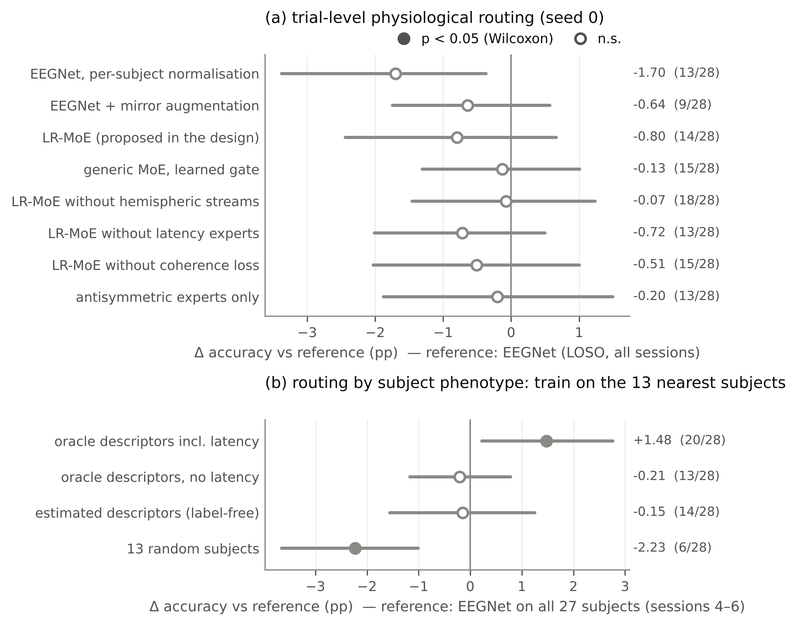
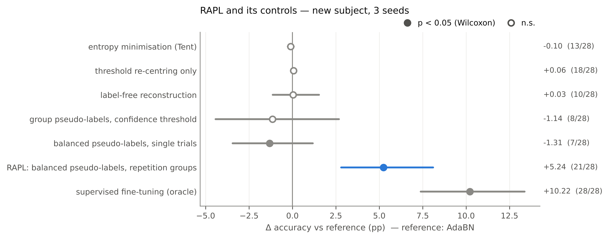
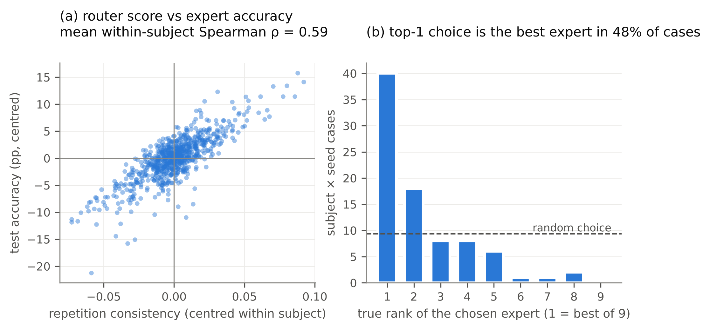
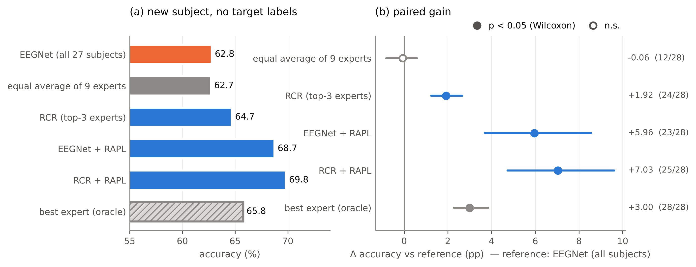
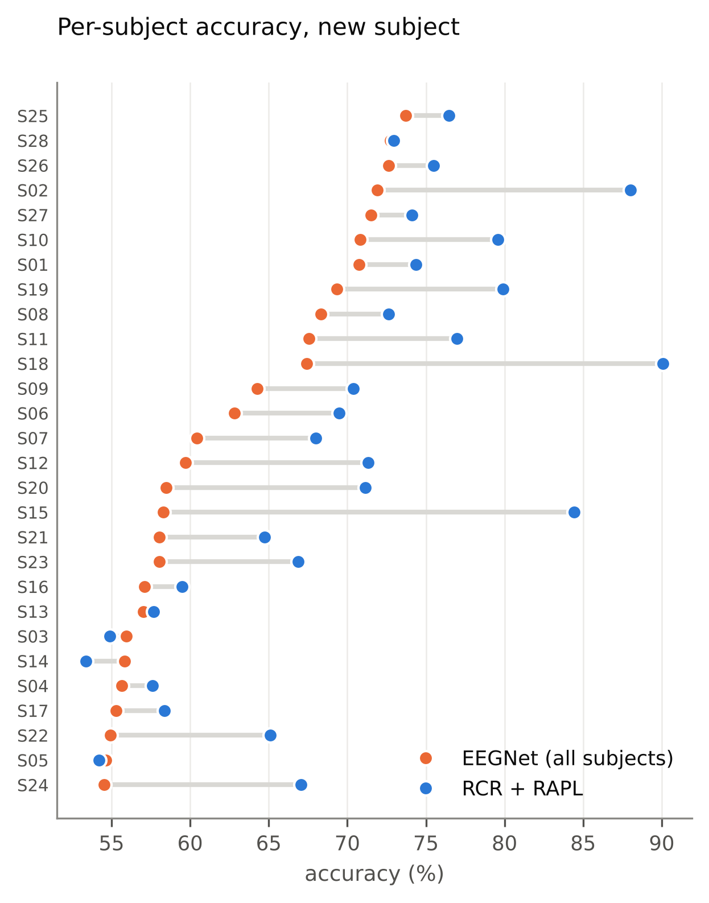
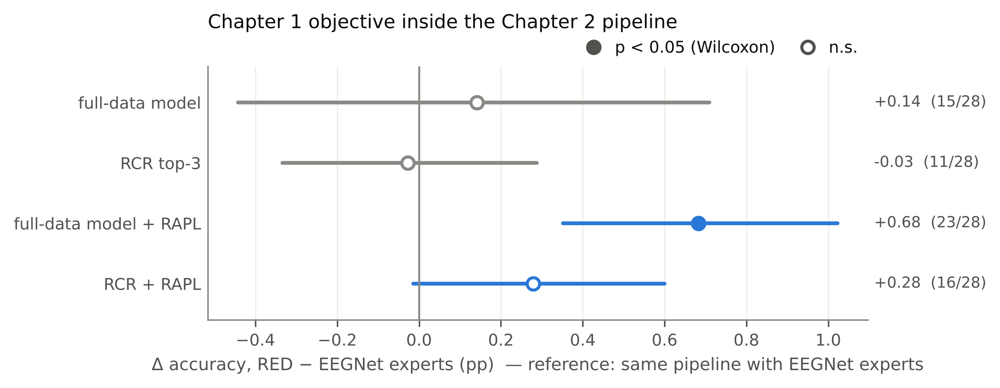

# Chapter 2 — Decoding a new subject without labels: repetition-guided expert routing and adaptation

> **Draft.** Every number below is computed from the committed results by
> `scripts/make_thesis_figures.py` (values in `figures/figure_data.json`) or taken from the round reports
> `reports/round4_analysis.md` – `reports/round8_analysis.md`. `[CITE]` marks a reference still to be
> inserted.

## 2.1 Introduction

Chapter 1 trained and tested within one subject, using 5 labelled calibration sessions. A speller
that has to work for a new user without calibration faces a harder problem. With a
leave-one-subject-out (LOSO) protocol, EEGNet falls from 74.5% to 62.3% single-trial accuracy, and
DCPM from 72.6% to 60.3%. This 12-point gap is the subject of this chapter.

The thesis proposal planned a **physiology-informed mixture of experts (MoE)**. aVEP direction is
encoded in the hemispheric lateralisation of the motion response, and subjects differ in how
strongly and how early they lateralise. A gate driven by these properties should therefore route
each subject, or each trial, to an expert suited to it. The chapter reports that this design fails
at the trial level, and diagnoses why. It then shows that the paradigm's **repetition structure**
supplies the label-free signal the MoE needs, both to choose experts per subject and to adapt them.

**Research questions.**

- **RQ2.1** Does a physiology-informed MoE improve zero-shot cross-subject decoding? If not, why
  not?
- **RQ2.2** Can a new subject's *unlabelled* data be used to adapt a cross-subject decoder, and
  which signal makes that adaptation safe?
- **RQ2.3** Can the same signal route a new subject to the right experts, without labels?

**Contributions.**

1. **Negative and diagnostic results on physiological routing.**
   - A trial-level, hemisphere-decomposed MoE (LR-MoE) does not beat EEGNet; its gate collapses to
     uniform.
   - Routing by the subject's true phenotype does help (+1.5 pp), but the gain rests on a latency
     descriptor that cannot be estimated without labels.
2. **RAPL — repetition-averaged pseudo-labelling.** A label-free adaptation procedure. It
   pseudo-labels repetition groups rather than trials, balancing classes within each session.
   It gains +5.2 to +6.0 pp over AdaBN in four independent runs; every control without the
   repetition averaging fails.
3. **RCR — repetition-consistency routing.** A subject-level MoE over subject-bagged experts. The
   router scores each expert by how consistent its single-trial predictions are with its own
   repetition-group pseudo-labels on the unlabelled data. It gains +1.9 pp over the full-data model,
   where a uniform ensemble of the same experts gains nothing.
4. **The combined pipeline, RCR + RAPL.** It raises new-subject accuracy from 62.8% to 69.8%
   (+7.0 pp, 25/28 subjects) without any target label.
5. **A link to Chapter 1.** Experts trained with the RED objective adapt better under RAPL.

**Scope.**

- No labels of the test subject are ever used, except by reference oracles that are marked as
  such.
- Unlabelled data of the test subject (sessions 1–3) are used for routing and adaptation.
- All testing is on sessions 4–6, which are never touched before evaluation.

## 2.2 Related work

*(To be written. Points to cover.)*

- Cross-subject EEG transfer: Euclidean / Riemannian alignment, domain adaptation, subject-invariant
  features [CITE].
- Mixture-of-experts models and gating, and the gate-collapse problem [CITE Jacobs; Shazeer].
- Test-time adaptation: AdaBN, Tent [CITE], pseudo-labelling and self-training [CITE], class-balance
  priors in pseudo-labelling [CITE].
- Model selection without target labels: unsupervised validation, agreement-based and
  consistency-based scores [CITE].
- Inter-subject variability of motion-onset and lateralised VEPs [CITE].

## 2.3 Setup

**Data and preprocessing.** As in Chapter 1, Section 1.3.

**Protocol.** Leave one subject out.

- **Training and validation.** For target subject s, the other 27 subjects provide labelled
  training data. Some of them are held out for early stopping: 3 subjects in round 4 (24 for
  training), 2 subjects of every expert's training pool in rounds 5–8.
- **Adaptation and routing.** Use only the target's sessions 1–3, without labels.
- **Testing.** On the target's sessions 4–6.

**Repetition groups.** As in Chapter 1, the up to six repetitions of one code bit form a group. In
a group all members share the same — unknown — label. Every session has the same number of trials
of each class (240 per class); this is a property of the paradigm design, not of the labels.

**Statistics.** As in Chapter 1:

- 3 seeds averaged per subject;
- paired differences with 95% bootstrap CIs;
- Wilcoxon signed-rank tests, n = 28.

## 2.4 Physiological routing: what fails and why (RQ2.1)

### 2.4.1 LR-MoE, a trial-level hemispheric mixture of experts

**Mirror operator.** M swaps the 9 left/right channel pairs and keeps the midline channels. M turns
a left→right response into a right→left one, so it flips the label. A trial x splits into:

| Stream | Definition | Behaviour under M |
|---|---|---|
| Antisymmetric | x_a = (x − Mx)/2 | changes sign |
| Symmetric | x_s = (x + Mx)/2 | unchanged |

**Experts.**

- *Antisymmetric experts*, f(x_a) − f(−x_a), are exactly mirror-equivariant.
- *Symmetric experts* act on x_s.
- A full expert acts on x.
- Each expert has variants with time shifts of −20, 0 and +20 ms, to capture latency differences.

**Gate.** An MLP on 13 mirror-invariant physiological descriptors: stream energies in 5 windows,
their log ratio, absolute L/R power asymmetry, and 10-Hz occipital amplitude.

**Training losses.** Cross-entropy, plus a load-balancing term and a subject-coherence term
(`docs/chapter2.md`, C2.1).

**Figure 2.1.** (a) Trial-level MoE variants against EEGNet (LOSO, all six sessions, seed 0).
(b) Training on the 13 subjects nearest in phenotype space, against EEGNet trained on all
27 subjects (sessions 4–6, 3 seeds). Filled points: p < 0.05.

**Result.**

- **No LR-MoE variant beats EEGNet** (Figure 2.1a): the range is −0.07 to −0.80 pp, all n.s.
- The proposed configuration gives −0.80 pp.
- The ablation without the hemispheric decomposition (−0.07 pp) and a generic MoE with a learned
  gate (−0.13 pp) are no better.

**Why it fails.** The gate entropy reaches 0.996 of its maximum, so the gate routes almost
uniformly. On single trials with an SNR of about −16 dB, the descriptors are dominated by noise. A
trial-level gate cannot identify which expert suits the trial, and the MoE degenerates into an
ensemble (`reports/round4_analysis.md`).

### 2.4.2 Subject-level phenotype routing: an oracle feasibility test

If trial-level routing is too noisy, routing could be done per *subject*. Three descriptors were
computed from each subject's labelled class averages:

- **mirror correlation**: how mirror-symmetric the two class responses are;
- **lateralisation latency**: peak time of the class-difference;
- **antisymmetric energy ratio**.

For each target, an EEGNet was trained on the 13 source subjects nearest in descriptor space.

**With the true descriptors, routing helps** (`reports/round5_analysis.md`):

| Comparison | Δ (pp) | Subjects improved |
|---|---|---|
| Nearest-phenotype subjects vs 13 random subjects | +4.1 | 22/28 |
| Nearest-phenotype subjects vs all 27 subjects | +1.8 | 19/28 |
| Nearest-phenotype subjects vs all 27 subjects, sessions 4–6, in-run reference (Figure 2.1b) | +1.48 | 20/28 (p = 0.026) |

So subject heterogeneity is real and exploitable.

**Without labels, it does not** (`reports/round6_analysis.md`). Two of the descriptors can be
estimated without labels, from balanced group pseudo-labels (Section 2.5):

| Descriptor | r(estimate, truth) |
|---|---|
| mirror correlation | 0.81 |
| antisymmetric ratio | 0.78 |

Yet routing on these two descriptors does not help, with estimated *or even true* values
(−0.15 / −0.21 pp, Figure 2.1b). The oracle gain is carried by the latency descriptor, and latency
cannot be estimated without labels (|r| ≤ 0.27 for every label-free proxy). It acts partly as a
label-dependent marker of how reliable the subject's response is.

**Conclusion of Section 2.4.** Physiological descriptors are either too noisy (trial level) or not
observable without labels (subject level) to drive routing. A different label-free signal is
needed.

## 2.5 RAPL: repetition-averaged pseudo-labelling (RQ2.2)

### 2.5.1 Method

**Starting point.** A source model f (EEGNet; in round 4, EEGNet plus the linear decoder of
Chapter 1) trained on the source subjects, and the target's unlabelled adaptation trials with their
repetition-group ids.

**Procedure.**

1. **AdaBN.** Re-estimate the batch-normalisation statistics on the target trials [CITE].
2. **Group scores.** In each epoch, compute the mean predicted P(class 1) of each repetition group:
   p̄_g = mean_{i ∈ g} f(x_i).
3. **Balanced selection per session.** Within each adaptation session, rank the groups by p̄_g.
   Label the top q fraction as class 1 and the bottom q fraction as class 0; leave the rest
   unlabelled. Selection is per session because the paradigm presents both classes equally often
   in every session.
4. **Encoder update.** Update the encoder with cross-entropy on the selected trials, plus a
   diversity term (the negative entropy of the batch-mean prediction). The classifier layer stays
   frozen, so the source decision space is kept.

**Setting.**

- A priori (round 4): q = 0.3, 10 epochs, learning rate 5 × 10⁻⁴.
- With nested selection on held-out source subjects, `q30_e20` (q = 0.3, 20 epochs) was chosen
  most often. It is then fixed for rounds 6–8.

**Why it works.**

- **Averaging.** A group mean over up to six repetitions is far more reliable than a single-trial
  prediction: pseudo-label accuracy is 74–75%, against single trials that are only 62% correct.
- **Ranking within a session** removes the threshold shift a new subject causes. That shift is
  what makes plain confidence-thresholded pseudo-labels collapse to one class.

### 2.5.2 Results

Figure 2.2 compares RAPL with its controls. All methods start from the same source model with AdaBN
(3 seeds, `results/adapt_pilot_v2`).

**Figure 2.2.** Label-free adaptation methods against AdaBN on a new subject. The supervised oracle
fine-tunes with the true labels of sessions 1–3 and serves as an upper reference only.

| Method | Δ vs AdaBN (pp) | Subjects improved |
|---|---|---|
| Entropy minimisation (Tent) | −0.10 | 13/28 |
| Threshold re-centring only | +0.06 | 18/28 |
| Label-free Noise2Noise reconstruction | +0.03 | 10/28 |
| Group pseudo-labels with a confidence threshold | −1.14 | 8/28 |
| Balanced pseudo-labels on single trials | −1.31 | 7/28 |
| **RAPL** (balanced pseudo-labels on repetition groups) | **+5.24** | **21/28** |
| Supervised fine-tuning (oracle) | +10.22 | 28/28 |

**Both ingredients are needed.**

- *Balance alone* (threshold re-centring) does nothing.
- *Repetition averaging without balance* (confidence-thresholded group labels) collapses to one
  class.
- *Balance without averaging* (single-trial ranking) hurts.

Only the combination works.

**The result replicates.**

| Run | Source model | Δ (pp) | Subjects improved |
|---|---|---|---|
| Pilot (above) | EEGNet + decoder, per-subject normalisation | +5.24 | 21/28 |
| Round 4, nested selection | EEGNet + decoder, 3 seeds | +5.71 | 23/28 |
| Round 6 | plain EEGNet source, global normalisation | +5.20 | 26/28 |
| Round 7 | full-data model | +5.96 | 23/28 |

RAPL recovers about half of the supervised-oracle gain.

**Safety rule.** A rule that skips adaptation when label-free diagnostics look poor was not reliable
across seeds (`reports/round4_analysis.md`), and is not part of the method. In the final pipeline,
3 of 28 subjects end below the unadapted full-data model, by 0.5–2.5 pp.

## 2.6 RCR: repetition-consistency routing (RQ2.3)

### 2.6.1 Method

**Expert pool.** For each target:

- the **full-data EEGNet**, trained on all 27 source subjects;
- **8 bagged EEGNets**, each trained on a random 13 of the 27 source subjects.

Bagging produces experts with genuinely different subject mixtures, as phenotype routing would,
without needing any descriptor.

**Router score.** For each expert e, on the target's unlabelled sessions 1–3:

1. Compute the balanced repetition-group pseudo-labels ŷ_g^e from e's own predictions (as in RAPL,
   split at the per-session median).
2. Measure the agreement of e's single-trial decisions with those labels:

  cons(e) = mean_i 1[ f_e(x_i) > 0.5 = ŷ^e_{g(i)} ].

**Interpretation.** For an expert that captures this subject's response, single trials agree with
their repetition-group consensus. For an expert that mostly sees noise, they scatter. The score
uses only the paradigm's repetition structure. It needs no labels and no physiological descriptor.

**Routing rules,** fixed before any result:

| Rule | Definition |
|---|---|
| top-1 | the highest-scoring expert |
| top-3 | mean probability of the 3 highest-scoring experts |
| soft | weights softmax(cons / 0.02) |

**Combination with RAPL.** RAPL (q30_e20) adapts each routed expert on sessions 1–3. For top-3,
RAPL is applied to each of the three experts and their probabilities are averaged.

### 2.6.2 Does the router choose good experts?

**Figure 2.3.**
(a) Router score against test accuracy, for every expert of every subject and seed, both centred
within subject.
(b) True rank, among the 9 experts, of the expert the top-1 rule chooses. The dashed line is the
expected count under random choice.

**The score tracks accuracy.**

- The mean within-subject Spearman correlation between cons and test accuracy is 0.59.
- The top-1 choice is the truly best expert in 48% of cases. Random choice would give 11%.
- The median true rank of the chosen expert is 2.
- The full-data model is chosen in only 10% of cases.

### 2.6.3 The full pipeline

**Figure 2.4.** New-subject accuracy (sessions 4–6) without target labels.
(a) Absolute accuracy.
(b) Paired gain over the full-data EEGNet.
The best-expert oracle selects by test labels and serves as a reference only.

| Method | Accuracy (%) | Δ vs full model (pp) | 95% CI | Subjects improved | p |
|---|---|---|---|---|---|
| EEGNet, all 27 subjects | 62.78 | — | | | |
| Equal average of the 9 experts | 62.72 | −0.06 | [−0.81, 0.58] | 12/28 | 0.78 |
| RCR top-1 | 64.73 | +1.95 | | 22/28 | 4 × 10⁻⁴ |
| **RCR top-3** | **64.70** | **+1.92** | [1.24, 2.65] | **24/28** | < 10⁻⁴ |
| RCR soft | 64.69 | +1.92 | | 23/28 | < 10⁻⁴ |
| Best expert (oracle) | 65.78 | +3.00 | [2.28, 3.85] | 28/28 | |
| EEGNet + RAPL | 68.74 | +5.96 | [3.69, 8.55] | 23/28 | 1 × 10⁻⁴ |
| **RCR top-3 + RAPL** | **69.81** | **+7.03** | [4.73, 9.61] | **25/28** | < 10⁻⁴ |

**Routing is selection, not ensembling.** The uniform average of the same nine experts gains
nothing. Routing by repetition consistency gains +1.9 pp, about two thirds of the best-expert
oracle (+3.0 pp). The three routing rules give the same result, so the outcome does not depend on
the choice of rule.

**Routing and adaptation add up.**

- RCR + RAPL beats EEGNet + RAPL by +1.07 pp (24/28, p = 1 × 10⁻⁴).
- This gain is positive in every seed: +1.34, +1.39 and +0.48 pp.

**The final pipeline reaches 69.8% on a new subject without labels.** This closes 7.0 of the
12-point gap between LOSO and within-subject EEGNet.

### 2.6.4 Per subject

**Figure 2.5.** New-subject accuracy per subject: the full-data EEGNet (orange) and RCR + RAPL
(blue). Subjects are sorted by full-model accuracy.

**Largest gains.** The largest gains go to subjects with a clear but atypical response, for whom the
pooled model fits poorly:

| Subject | Full model | RCR + RAPL |
|---|---|---|
| Sub18 | 67.4% | 90.1% |
| Sub15 | 58.3% | 84.4% |
| Sub02 | 71.9% | 88.0% |

These are the strong lateralisers identified by the phenotype analysis.

**Losses.**

- Three subjects lose: Sub14 −2.5, Sub03 −1.1 and Sub05 −0.5 pp.
- All three are among the weakest subjects for the full model (about 55–56%), where the repetition consensus carries
  little information.

### 2.6.5 Experts trained with the Chapter 1 objective

Round 8 retrained every expert with RED (single-trial critic). The draws of subjects were identical
to round 7, so each RED expert is paired with an EEGNet expert that differs only in training
objective.

**Figure 2.6.** Paired difference, RED experts minus EEGNet experts, for the same pipeline.

| Pipeline | RED − EEGNet experts (pp) | Subjects improved | p |
|---|---|---|---|
| Full-data model | +0.14 | 15/28 | 0.46 |
| RCR top-3 | −0.03 | 11/28 | 0.69 |
| **Full-data model + RAPL** | **+0.68** | **23/28** | **4 × 10⁻⁴** |
| RCR top-3 + RAPL | +0.28 | 16/28 | 0.19 |

**Zero-shot, RED changes nothing,** consistent with its null result in the pooled protocol
(Chapter 1, Section 1.7).

**After adaptation, RED experts improve.**

- With RAPL, RED experts gain significantly on the full-data model (+0.68 pp).
- A plausible reading: RED's reconstruction of averaged repetitions makes the encoder preserve the
  repetition-consistent signal, and RAPL's group pseudo-labels rely on exactly that signal.

**Best overall pipeline.**

| Pipeline | Accuracy |
|---|---|
| RED experts, RCR + RAPL | 70.09% |
| EEGNet experts, RCR + RAPL | 69.81% |

The difference (+0.28 pp) is not significant. The link is therefore reported as an analysis, not as
the main pipeline.

## 2.7 Discussion

**The repetition structure is the label-free signal that routing and adaptation need.**

- Physiological descriptors failed as router inputs. On single trials they are too noisy. At the
  subject level the useful one — latency — needs labels.
- The repetition structure is free in every repetition-coded speller and needs no labels. It does
  three jobs:
  - it turns noisy single-trial predictions into reliable group pseudo-labels (RAPL);
  - it makes the class balance usable per session (RAPL);
  - it gives each expert a self-consistency score that predicts its accuracy on the new subject
    (RCR).

**From the planned MoE to RCR.** The chapter keeps the MoE idea — several experts, one router, a
subject-specific choice — but moves the routing decision:

| | Planned design | RCR |
|---|---|---|
| Routing unit | the trial | the subject |
| Router input | physiology | the repetition consistency of each expert's own predictions |

The failure of the planned design is informative. It shows that, at aVEP single-trial SNR, any
trial-level gate degenerates to an ensemble. The phenotype oracle shows that subject-level
heterogeneity is worth exploiting, if it can be observed without labels.

**Relation to unsupervised model selection.** RCR is a form of label-free model selection.
Agreement-based scores usually compare different models with each other [CITE]. RCR instead
compares each model with its own repetition consensus. This is possible only because the paradigm
repeats every bit, and it explains why the uniform ensemble fails where selection succeeds.

## 2.8 Limitations

- **Unlabelled data needed.** RCR and RAPL need unlabelled data of the new subject. Here this is
  three sessions (about 1,440 trials) before the tested sessions. The
  minimum amount, and an online variant that adapts as the user spells, have not been studied.
- **Small expert pool.** It is fixed and small: one full-data model and 8 bagged experts.
  Larger or more diverse pools may route better; the oracle bound with this pool is +3.0 pp.
- **Losses on poor subjects.** Three of 28 subjects lose slightly, and no label-free diagnostic
  reliably predicts which. RAPL is not guaranteed to help the weakest subjects.
- **One dataset.** Results come from a single dataset, and from a single architecture family
  (EEGNet).
- **One seed for LR-MoE.** The LR-MoE results are single-seed. Given the gate collapse and the
  uniformly null effects across eight variants, more seeds are not expected to change the
  conclusion.
- **Alignment baselines not included.** Explicit cross-subject alignment baselines (e.g. Euclidean
  alignment) were not part of the final experiments.

## 2.9 Conclusion

A physiology-gated mixture of experts does not improve cross-subject aVEP decoding. The gate cannot
read the physiology from single trials, and the subject-level physiology that matters cannot be
observed without labels.

The paradigm's repetition structure provides the missing signal:

- **RAPL** pseudo-labels repetition groups in a session-balanced way, and gains 5–6 pp over AdaBN;
- **RCR** routes each new subject to the experts whose predictions are most repetition-consistent,
  and gains 1.9 pp where a uniform ensemble gains nothing.

Combined, they raise new-subject accuracy from 62.8% to 69.8% without a single target label.

---

### Figure list

| Figure | File | Source data |
|---|---|---|
| 2.1 | `figures/ch2_negative_results.png` | `results/lrmoe*`, `results/eegnet*/loso`, `results/oracle_phen_knn`, `results/est_*` |
| 2.2 | `figures/ch2_rapl_controls.png` | `results/adapt_pilot_v2` |
| 2.3 | `figures/ch2_router.png` | `results/rcr_experts` |
| 2.4 | `figures/ch2_pipeline.png` | `results/rcr_*` |
| 2.5 | `figures/ch2_per_subject.png` | `results/rcr_full`, `results/rcr_top3_rapl` |
| 2.6 | `figures/ch2_red_experts.png` | `results/rcr_red_*`, `results/rcr_*` |
